# System Architecture Documentation

**Aarunodya Residency Bhakt Niwas — Property Management & Devotee Booking System**

---

## 1. High-Level Architectural Overview

The application is built on **Next.js 16 (App Router)** utilizing React 19, TypeScript, Tailwind CSS, and SheetJS. It follows a clean hexagonal architecture where presentation, business logic, storage abstraction, and external service adapters are strictly decoupled.

```mermaid
flowchart TD
    subgraph ClientLayer ["Client Layer (Responsive / Mobile-First)"]
        UI_Guest["Public Devotee Portal (Booking / Hold / Razorpay)"]
        UI_Admin["Admin PMS Dashboard (Walk-in, Cash Drawer, CRM, Excel)"]
    end

    subgraph APILayer ["API Routing Layer (Next.js Edge & Node.js Handlers)"]
        API_Auth["/api/auth/* (Staff Session Management)"]
        API_Reception["/api/admin/reception/* (Walk-ins, Cash Drawer, Shifts)"]
        API_Coupons["/api/coupons/* & /api/admin/coupons/* (Validation & Rules)"]
        API_Marketing["/api/admin/marketing/* (Post-Checkout Campaign & Outbox)"]
        API_CRM["/api/admin/customers/* & /api/admin/documents/* (Vault)"]
        API_Data["/api/admin/data/* (XLSX Export & Guided Batch Import)"]
    end

    subgraph ServiceLayer ["Business & Domain Services"]
        Repo["LodgeRepository (Singleton Domain Controller)"]
        Audit["Audit Logger (HMAC Verification & Access Trails)"]
        CouponEngine["Coupon Validation & Redemption Engine"]
        CashEngine["Cash Drawer & Shift Reconciliation Ledger"]
        ResendAdapter["Resend Email Adapter (devtushar.uk)"]
        ExcelEngine["SheetJS XLSX Generator & Ingestion Parser"]
    end

    subgraph StorageLayer ["Storage & Security Vault"]
        DB_JSON["Persistent JSON Ledger (data/lodge_database.json)"]
        DB_SQL["Relational PostgreSQL Schema (scripts/schema.sql)"]
        DocVault["Private Secure Document Store (data/secure_documents/)"]
    end

    ClientLayer --> APILayer
    APILayer --> ServiceLayer
    ServiceLayer --> StorageLayer
```



---

## 2. Directory Structure

```
lodge-management-system/
├── data/
│   ├── lodge_database.json       # Atomic local JSON database
│   └── secure_documents/         # Private, non-public government ID documents
├── scripts/
│   ├── schema.sql                # Complete normalized PostgreSQL schema
│   ├── test-engine.mjs           # Date overlap and financial paise test suite
│   ├── test-e2e.mjs              # 18-room physical allocation & hall test suite
│   ├── test-folio-invoice.mjs    # Front-desk invoice and GST split test suite
│   ├── test-token-continuity.mjs # Cryptographic continuity tests
│   └── test-advanced-features.mjs# Master test suite for the 5 advanced features
├── src/
│   ├── app/
│   │   ├── (public)/             # Public guest landing, room viewing, booking
│   │   ├── admin/(dashboard)/    # Admin PMS dashboard pages
│   │   │   ├── reception/        # Walk-in booking & Cash register
│   │   │   ├── coupons/          # Coupon management
│   │   │   ├── marketing/        # Post-checkout campaign & email outbox
│   │   │   ├── customers/        # Guest CRM & Document vault
│   │   │   └── data/             # Excel import & export center
│   │   ├── api/                  # All backend REST API route handlers
│   │   └── checkout/             # Online checkout with coupon input
│   ├── components/
│   │   ├── admin/                # Sidebar, modals, datatables, metrics cards
│   │   └── booking/              # Receipts, invoices, confirmation views
│   └── lib/
│       ├── auth/                 # HMAC-SHA256 session token management
│       ├── db/                   # Repository pattern & seed data
│       ├── services/             # Resend email and external integrations
│       ├── types/                # Domain models and TypeScript contracts
│       └── utils/                # Currency (paise), dates, tokens
```

---

## 3. Key Subsystems & Design Decisions

### 3.1 Financial Safety & Minor Units (Paise)
All financial amounts throughout the domain layer, database records, and API responses are calculated in **integer minor units (paise)**:
$$\text{Amount in Rupees} = \frac{\text{Amount in Paise}}{100}$$
This eliminates binary floating-point representation bugs (e.g. `0.1 + 0.2 = 0.30000000000000004`) in billing, coupons, cash payments, and refunds.

### 3.2 Concurrency & Double-Booking Prevention
- Check-in dates are **inclusive**; check-out dates are **exclusive**.
- Before confirming any booking hold or walk-in, the repository queries all overlapping active bookings for the candidate room.
- Holds expire automatically after 15 minutes if not completed.

### 3.3 Idempotent Post-Checkout Email Outbox
- The checkout handler records a hash of the booking reference in `emailNotifications`.
- If an admin clicks checkout repeatedly or reloads the page, the system verifies `alreadySent` and guarantees zero duplicate emails.
- Failed deliveries are stored with status `failed` and exact error reason, allowing staff to trigger safe retries.

### 3.4 Zero-Knowledge ID Document Vault
- Uploaded files are renamed to cryptographically random UUIDs and saved outside the `public/` folder.
- Government ID numbers are stored masked (`XXXX-XXXX-1234`).
- Streamed file access is protected by staff authentication and records an entry in the system audit log.
