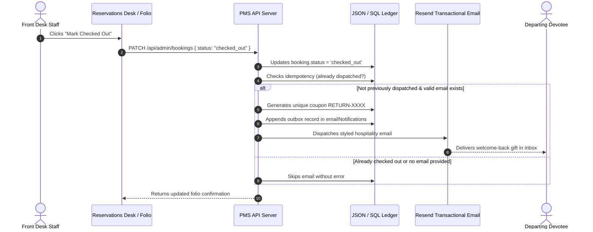

# Post-Checkout Loyalty Email & Retention Guide

**Aarunodya Residency Bhakt Niwas — Automated Guest Retention Engine**

---

## 1. Overview & Business Workflow

To build a loyal community of returning pilgrims, Aarunodya Residency automatically emails a thank-you note and an exclusive welcome-back gift voucher to devotees upon their departure from Pandharpur.

### Departure Workflow:

---

## 2. Managing Post-Checkout Campaigns

Access: **Post-Checkout Offers** (`/admin/marketing/post-checkout`)

### Configuration Controls:
- **Enable/Disable Switch:** Instantly turn automated email offers on or off.
- **Campaign Title & Email Subject:** Custom subject line (e.g. `Thank You for Staying With Us at Pandharpur! Special Gift 🎁`).
- **Blessing & Intro Text:** Welcoming devotional greeting acknowledging their pilgrimage to Shri Vitthal-Rukmini Mandir.
- **Discount Structure:** Percentage (e.g. 15%) or Fixed Rupee Amount (e.g. ₹300).
- **Validity Window:** Number of days before the return coupon expires (default: 90 days).
- **Ceilings & Spend Bounds:** Optional max discount cap and minimum spend on the next stay.

### Live Visual Email Preview:
Click the **Email Preview** tab to review the exact mobile-responsive branded HTML email template that the guest will receive.

---

## 3. Reliability & Idempotency Safeguards

1. **Zero Duplicate Emails:**
   - The checkout operation records the booking reference in `emailNotifications`.
   - Repeatedly clicking checkout or refreshing the admin folio never generates duplicate coupons or duplicate email dispatches.
2. **Transactional Outbox:**
   - Every dispatch attempt is logged with timestamp, recipient email, generated coupon code, delivery status (`sent`, `failed`, `pending`), and failure reasons.
3. **Manual Retry Tooling:**
   - In the event of temporary network interruptions or invalid email formatting, authorized staff can review the failure reason and click **Retry Email** directly from the audit table.
4. **Resend Domain Verification:**
   - Integrated with Resend API using verified host domain `devtushar.uk`.

